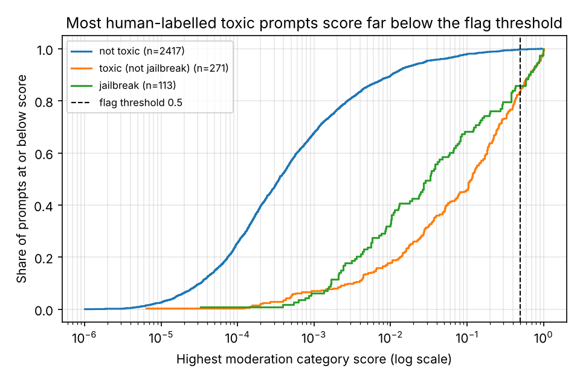
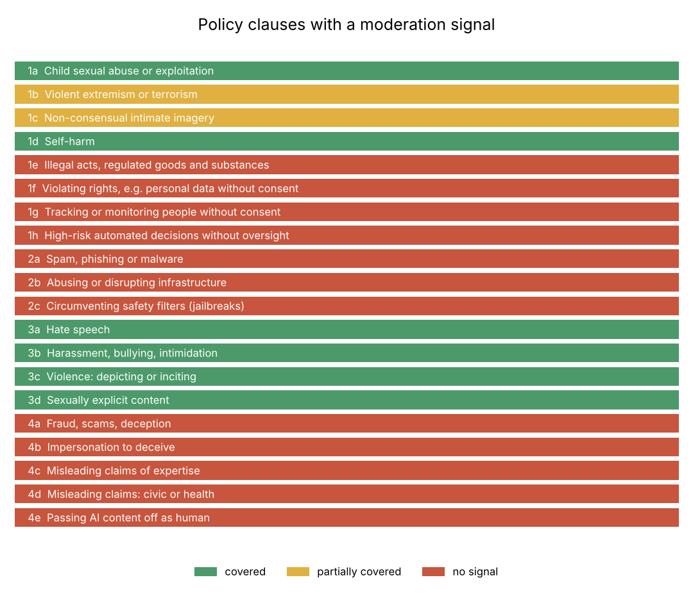
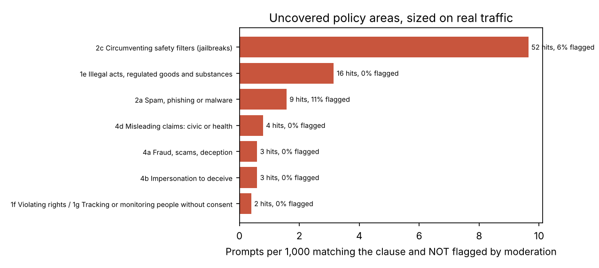

# GenAI policy risk analysis: what moderation misses on real user prompts

A written usage policy is only as strong as the signals that enforce it. This project
maps the 20 clauses of Google's **Generative AI Prohibited Use Policy** onto an
off-the-shelf moderation signal, then measures on **5,082 real user prompts** where the
two diverge and how much traffic falls into the gaps.

**Deliverable:** a decision memo, [reports/POLICY_MEMO.md](reports/POLICY_MEMO.md), backed by a
reproducible pipeline. Every figure in it comes from `reports/metrics.json`.


## Findings

| | Result |
|---|---|
| Policy clauses with **no** moderation category | **12 of 20** (6 covered, 2 partial) |
| Human-labelled toxic prompts flagged at the default 0.5 threshold | **15%** (95% CI 12-19%), precision 91% |
| ...at the best-F1 threshold (0.024, in-sample) | 68% recall, 66% precision, **6x the flag volume** |
| Human-labelled jailbreaks flagged by moderation | **14%** (CI 9-22%) |
| Jailbreaks caught by a 10-pattern lexicon / lexicon + moderation | 35% at 75% precision / **47%** |
| Drug- and explosive-making requests: human-toxic / flagged | **13 of 13 / 0 of 13** |

1. **Circumvention is the largest uncovered risk.** Jailbreak prompts are often polite
   and contain nothing toxic, so content categories cannot see them. About 10 in 1,000
   prompts match the jailbreak lexicon, and moderation flags 6% of those.
2. **Calibration, not coverage, explains most misses in covered areas.** The categories
   exist, but scores sit well below 0.5. Choosing a threshold is a policy decision with
   a measurable review-load cost, and the memo quantifies it.
3. **Some clauses have no signal at all.** Regulated-goods instructions are rare, but
   every one is missed. Fraud, malware and privacy were too rare here to size, which
   makes them a monitoring gap rather than a clean result.







## Method

1. **Policy encoding** ([`configs/policy.yaml`](configs/policy.yaml)). The 20 clauses, a
   crosswalk from moderation categories to clauses (full or partial), and auditable regex
   detectors for clauses without a category, with a revision log.
2. **Detection quality.** Moderation max-score against ToxicChat's *human* toxicity and
   jailbreak labels: PR-AUC, recall and precision at the default and best-F1 thresholds,
   Wilson intervals, and flag volume per 1,000 prompts (the operational cost).
3. **Gap sizing.** Detectors run over all prompts. For each clause: prevalence per 1,000,
   the moderation flag rate among hits, and the human toxic/jailbreak rate among hits.
4. **Risk ranking.** Unflagged prevalence × severity. Severity is a stated judgement and
   does not change the order.
5. **Miss themes.** NMF topics over toxic prompts that moderation missed, reported as top
   terms only.

### A data trap worth knowing about

ToxicChat's 2,281 prompts without human annotation are *all* labelled non-toxic, and
their 99th-percentile moderation score is 0.007. They were cleared by a moderation
pre-filter. Grading moderation against those labels would be circular, so every
label-based number here uses the 2,801 human-annotated prompts only. The pipeline
checks and records this (`metrics.json → dataset`).

### Guarding against tuning on the evaluation data

The jailbreak lexicon was written before looking at labels. One pattern
(`imagine you are a ...`) was then replaced after reading eight random hits, because it
matched ordinary role-play. Both versions are scored and reported (precision 58% → 75%,
recall unchanged), so the effect of that one data-informed change is visible.

## Run it

```bash
pip install -e ".[dev]"
policy-risk            # downloads ToxicChat (checksum-verified), writes reports/
pytest
```

```
src/policy_risk/
  data.py        download + checksum, moderation parsing, human-annotated subset
  analysis.py    coverage, detection quality, gap sizing, risk ranking, miss themes
  pipeline.py    metrics.json, tables, figures
configs/policy.yaml   policy clauses, crosswalk, detectors, revision log
reports/              POLICY_MEMO.md, metrics.json, tables/, figures/
```

## Content and licensing

The prompts include sexual and violent content. The repository publishes no prompt
text, only counts, rates and topic terms. ToxicChat is CC-BY-NC-4.0 and is downloaded at
run time, not redistributed. The policy is paraphrased for analysis; the
[published policy](https://policies.google.com/terms/generative-ai/use-policy) is authoritative.
